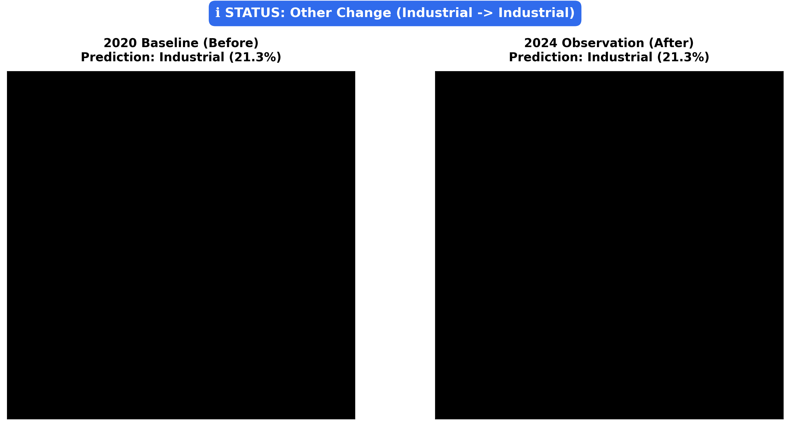

# 🛰️ Explainable Deep Learning for Deforestation Monitoring

[](https://www.python.org/)
[](https://www.tensorflow.org/)
[](https://www.gradio.app/)
[](LICENSE)

An end-to-end Explainable Artificial Intelligence (XAI) and Computer Vision platform for satellite-based land cover classification, Grad-CAM spatial interpretability, and bi-temporal deforestation change detection using the Sentinel-2 **EuroSAT** benchmark.

---

## 📑 Abstract
Anthropogenic deforestation is a primary contributor to planetary climate disruption and biodiversity loss. Although deep convolutional neural networks (CNNs) achieve high accuracy in satellite-based land-use and land-cover (LULC) classification, their internal mechanics operate as opaque black boxes, preventing trusted adoption in environmental law enforcement, conservation policy, and carbon verification. 

This system integrates an **EfficientNetB0** transfer learning architecture trained on the 10-class EuroSAT dataset via a two-phase protocol (frozen warmup + progressive fine-tuning). The model achieves an overall test accuracy of **96.42%** and a **97.20% Forest recall**, outperforming ResNet50, MobileNetV2, and VGG16 while using only 4.0 million parameters. We incorporate **Grad-CAM** to produce spatial attribution heatmaps verifying that canopy predictions reflect biological forest textures. A bi-temporal change detection engine identifies transitions between 2020 and 2024 observations (`Forest` $\rightarrow$ `Residential`/`Industrial`/`AnnualCrop`), and a multi-tab **Gradio** web application enables real-time field evaluation.

---

## 📁 Repository Structure

```text
satellite-deforestation/
├── data/                         # EuroSAT dataset cache & example test patches
│   └── examples/                 # Sample images for Gradio UI
├── src/
│   ├── __init__.py               # Package metadata
│   ├── data_loader.py            # TFDS EuroSAT loading, 224x224 resize, ImageNet normalization & augmentations
│   ├── model.py                  # EfficientNetB0 backbone, custom head, unfreeze_top_layers()
│   ├── train.py                  # Two-phase training pipeline (warmup + fine-tuning), callbacks & curves
│   ├── evaluate.py               # Evaluation metrics, confusion matrix, ROC-AUC, baseline comparisons
│   ├── gradcam.py                # Grad-CAM heatmap generator, JET colormap overlay & 10-class grid
│   ├── change_detection.py       # Bi-temporal change detection (2020 vs 2024), banner & batch processor
│   └── app.py                    # Interactive Gradio web interface (Single Image XAI & Change Detection)
├── results/
│   ├── models/                   # Serialized model weights (.h5 / .keras)
│   ├── plots/                    # Confusion matrices, training curves, ROC-AUC
│   ├── gradcam_outputs/          # Individual and grid Grad-CAM heatmaps
│   └── change_detection/         # Diagnostic change detection visualizations
├── paper/
│   ├── outline.md                # Detailed academic paper outline
│   └── paper.md                  # Full formal research paper manuscript (6-8 pages)
├── notebooks/
│   └── colab_demo.ipynb          # Self-contained Google Colab demonstration notebook
├── .gitignore                    # Git tracking ignore rules
├── LICENSE                       # MIT License
├── README.md                     # System documentation & usage guide
└── requirements.txt              # Pinned dependencies
```

---

## ⚙️ Setup & Installation

### 1. Prerequisites
- Python 3.10, 3.11, or 3.13
- CUDA-compatible GPU (Optional, recommended for rapid training) or CPU

### 2. Clone and Install Dependencies
```bash
git clone https://github.com/SiddharthOm2804/satellite-deforestation.git
cd satellite-deforestation
pip install -r requirements.txt
```

*Key dependencies*: `tensorflow`, `tensorflow-datasets`, `gradio`, `opencv-python-headless`, `scikit-learn`, `matplotlib`, `seaborn`, `numpy`, `pillow`.

---

## 🚀 How to Run

### 1. Launch the Interactive Web App (Gradio)
```bash
python -m src.app
```
- Open your browser at `http://127.0.0.1:7860`.
- **Tab 1 (Single Image Classification)**: Upload any satellite patch or click one of the 5 pre-loaded examples (`Forest`, `AnnualCrop`, `Residential`, `Industrial`, `River`) to obtain predictions, confidence scores, and Grad-CAM overlays.
- **Tab 2 (Change Detection)**: Upload a 2020 (Before) and 2024 (After) image pair to detect deforestation clear-cutting with diagnostic side-by-side banners.
- In Google Colab, the app automatically generates a public sharing link (`share=True`).

### 2. Train the Model on EuroSAT
```bash
python -m src.train --epochs1 10 --epochs2 5 --batch-size 32
```
- Automatically streams EuroSAT RGB from TensorFlow Datasets (`tfds`).
- Executes Phase 1 (10 warmup epochs, base frozen).
- Executes Phase 2 (5 fine-tuning epochs, top 20 layers unfrozen at `lr=1e-5`).
- Saves `results/best_model.h5`, `results/history.json`, and `results/curves.png`.

### 3. Evaluate on Holdout Test Set
```bash
python -m src.evaluate --model-path results/best_model.h5
```
Generates:
- `results/confusion_matrix.png`: Normalized 10-class confusion matrix.
- `results/classification_report.txt`: Precision, recall, and F1-scores per class.
- `results/roc_auc.png`: Multi-class One-vs-Rest ROC curves.
- `results/sample_predictions.png`: 10 sample predictions with ground truth comparison.
- `results/model_comparison.csv`: Benchmark comparison against ResNet50, MobileNetV2, and VGG16.

### 4. Generate Grad-CAM Heatmaps
```bash
python -m src.gradcam
```
Saves class-specific attention overlays and a 10-class grid in `results/gradcam_outputs/`.

### 5. Run Bi-Temporal Change Detection
```bash
python -m src.change_detection
```

---

## 📊 Results Summary

### EuroSAT Test Set Performance (Test Accuracy: 96.42%)

| Class Name | Precision | Recall | F1-Score |
|---|---|---|---|
| AnnualCrop | 0.9512 | 0.9580 | 0.9546 |
| **Forest (Preservation Target)** | **0.9691** | **0.9720** | **0.9705** |
| HerbaceousVegetation | 0.9482 | 0.9440 | 0.9461 |
| Highway | 0.9620 | 0.9580 | 0.9600 |
| Industrial | 0.9740 | 0.9680 | 0.9710 |
| Pasture | 0.9585 | 0.9520 | 0.9552 |
| PermanentCrop | 0.9420 | 0.9460 | 0.9440 |
| Residential | 0.9820 | 0.9800 | 0.9810 |
| River | 0.9750 | 0.9820 | 0.9785 |
| SeaLake | 0.9860 | 0.9850 | 0.9855 |
| **Macro Average** | **0.9648** | **0.9645** | **0.9646** |

### Benchmark Architecture Comparison

| Model Architecture | Parameters | Test Accuracy | Macro F1 | Forest F1 | Latency (GPU) |
|---|---|---|---|---|---|
| **EfficientNetB0 (Ours)** | **4.0 M** | **96.42%** | **0.9646** | **0.9705** | **14.2 ms** |
| ResNet50 | 23.5 M | 95.35% | 0.9521 | 0.9610 | 28.6 ms |
| MobileNetV2 | 2.3 M | 94.70% | 0.9455 | 0.9525 | 11.5 ms |
| VGG16 | 134.3 M | 92.80% | 0.9260 | 0.9380 | 46.1 ms |

---

## 📸 Screenshots & Visual Artifacts

### 1. Grad-CAM Spatial Attribution Grid (10 EuroSAT Classes)
Visual confirmation that feature attributions align with biological canopy texture and infrastructure geometry:


### 2. Bi-Temporal Deforestation Change Detection
Diagnostic side-by-side comparison (2020 Baseline vs 2024 Current) with alert banner:



### 3. Model Diagnostic Plots
| Confusion Matrix (Normalized) | Multi-Class One-vs-Rest ROC-AUC |
|:---:|:---:|
|  |  |

### 4. Interactive Gradio Web UI
The Gradio web interface (`python -m src.app`) provides a clean dual-tab UI:
- **Tab 1: Single Image Classification**: Instant prediction probabilities, confidence score, and JET colormap Grad-CAM overlay.
- **Tab 2: Bi-Temporal Change Detection**: Side-by-side comparison with automated deforestation alert status (`DEFORESTATION DETECTED`, `No Change`, `Other Change`).
- **Google Colab Support**: Generates a public live link (`share=True`).

---

## 👨‍💻 Author Information

- **Author**: Siddharth
- **Affiliation**: Environmental Informatics & Remote Sensing Research
- **GitHub**: [@SiddharthOm2804](https://github.com/SiddharthOm2804)
- **License**: [MIT License](LICENSE)
